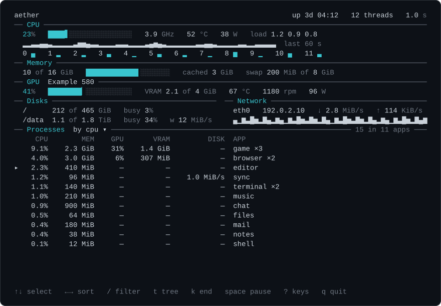

# aether

The whole machine as numbers: CPU, memory, GPUs, sensors, disks, network, battery, and every
process with what it uses. In a terminal it draws a full-screen view; piped, it prints numbers.

It is a Rust library (the core) with a small command-line program on top. Licence GPL-3.0-only.



The values in the picture are made up.

## Install

### One line

Downloads the latest release for your system and processor, checks it against `SHA256SUMS` and
puts it on your `PATH`, so typing `aether` starts it. Run the same line again to update.

Linux and macOS (installs to `/usr/local/bin`, asking for sudo only if it has to):

    curl -fsSL https://raw.githubusercontent.com/tarikee/aether/main/install.sh | sh

Windows, in PowerShell (installs to `%LOCALAPPDATA%\Programs\aether` and adds that folder to your
`PATH`):

    irm https://raw.githubusercontent.com/tarikee/aether/main/install.ps1 | iex

Both read two settings: `AETHER_VERSION` installs a given release instead of the latest
(`AETHER_VERSION=v0.1.1`), and `AETHER_INSTALL_DIR` picks another folder. Every release runs
both lines on Linux (x86_64 and ARM), macOS and Windows right after it is published. The scripts
are short: read [install.sh](install.sh) or [install.ps1](install.ps1) before you run them.

### Packages

Debian, Ubuntu, Mint and other apt systems: download the `.deb` for your processor from the
[releases page](https://github.com/tarikee/aether/releases), then

    sudo apt install ./aether_*_amd64.deb      # or _arm64.deb

Fedora, Nobara, openSUSE and other rpm systems:

    sudo dnf install ./aether-*.x86_64.rpm     # or .aarch64.rpm

Updates come the same way, from the newer file. These put `aether` in `/usr/bin`.

### By hand

Every release on the [releases page](https://github.com/tarikee/aether/releases) has these
archives. Each holds the program, `LICENSE` and `README.md`; `SHA256SUMS` lists their checksums.

| File | For |
|---|---|
| `aether-linux-x86_64.tar.gz` | any x86_64 Linux (one static program, no libraries needed) |
| `aether-linux-arm64.tar.gz` | any 64-bit ARM Linux, such as a Raspberry Pi 3 or later (static too) |
| `aether-macos-arm64.tar.gz` | Macs with Apple silicon |
| `aether-macos-x86_64.tar.gz` | Macs with an Intel processor |
| `aether-windows-x86_64.zip` | 64-bit Windows |

Unpack it and run `aether` from that folder, or move it to a folder on your `PATH`
(`sudo mv aether /usr/local/bin/`). On macOS a downloaded program is held back the first time
because it is not signed by Apple: `xattr -d com.apple.quarantine aether` once releases it.

### Remove

- One line or by hand on Linux and macOS: `sudo rm /usr/local/bin/aether` (or wherever you put it).
- One line on Windows: delete `%LOCALAPPDATA%\Programs\aether` and remove it from your `PATH`
  (Settings, "Edit environment variables for your account").
- Packages: `sudo apt remove aether` or `sudo dnf remove aether`.

aether writes nothing else to your disk unless you ask it to (`record`, or a file of default
arguments you made yourself).

### From source

With a stable Rust toolchain (1.87 or newer):

    cargo install --git https://github.com/tarikee/aether

From a clone:

    cargo install --path .

Or build without installing: `cargo build --release`, then `target/release/aether`.

## What it shows

- CPU: total use, every thread, GHz, temperature, load average.
- Memory: used, available, cached, swap, pressure.
- GPUs: use, VRAM, temperature, fan speed, power.
- Every sensor: temperatures, fans and power, with names.
- Disks: space used, busy time, and read and write rates, per mount.
- Network: receive and send rates per interface, with a graph of each, and the link's speed.
- Battery, on a laptop, and uptime.
- Every process: CPU %, memory, GPU % and VRAM, disk read and write rates, threads, user and age.
  Processes are grouped by app by default.

The full-screen view is shown when the output is a terminal, and not with `--once`, `--json` or
`--plain`. It needs a UTF-8 locale and at least 60 columns and 15 rows. Its first line holds the
whole machine at a glance: CPU, GPU, RAM and network in percent (network as the busier direction's
share of the link's speed, or the rate when the speed is not known). Below that it fills the terminal: each
part in its own box, bars that stretch to their line, graphs of the last readings (CPU, memory,
the first GPU, the first interface), a bar per CPU thread (a cell each when there are too many),
and the process table down to the last row. From 140 columns the CPU sits beside memory and the
GPUs, and disks, network and sensors share a row; from 100, memory sits beside the GPU and disks
beside network; below that, one box per row. A short terminal gives up graph rows, then the
sensors, then the thread bars, so the process table keeps 8 rows (5 under 30 rows).

## The view's keys

| Key | What it does |
|---|---|
| `↑ ↓  PgUp PgDn` | select a process |
| `Home End` | the first or the last one |
| `← →` | the sort key |
| `r` | reverse the order |
| `t` | tree (f: flat; grouped is the default) |
| `/` | filter by name or command line; Enter keeps it, Esc clears it |
| `space` | pause the list |
| `Enter` | the selected process in full |
| `k  K` | end it, or force it (then y or n) |
| `+  -` | the interval |
| `s` | every sensor, in place of the table |
| `?` | this help |
| `q` | quit |

The mouse works in the view too (`--no-mouse` turns it off; `--no-keys` turns keys and mouse
off). Click a process to select it, double-click for its detail. Click a column header to sort by
it, again to reverse. The wheel over the table moves the selection 3 rows. A click on a key in the
bottom border does what that key does. The terminal must send SGR mouse reports (most do); the
view turns them on when it starts and off again when it leaves.

## Commands

```
aether: the whole machine as numbers.

Usage:
  aether [-i SECS] [--by KEY] [--reverse] [--steady] [--filter TEXT] [--flat] [--all] [--only LIST] [--json]
      live: every vital and every process, rewritten in place
  aether --once [same options]
      one reading, then exit
  aether port [PORT] [--all] [--json]
      the listening sockets: protocol, address, port, pid, process, user, sorted by port.
      PORT shows who holds that port, listening or connected; --all adds connections.
      A process that cannot be seen shows a dash (root shows it).
  aether proc PID|NAME|:PORT
      one process in full: command line, program, folder, parents, CPU time, open files
  aether kill PID|NAME|:PORT [--force] [-y] [-s NAME|NUMBER]
      asks the process to stop and waits 3 s; says if it is still there.
      --force kills it. By NAME it lists the matches and asks first; -y skips the question.
      -s sends that one signal and does not wait. :PORT is the process listening on it.
  aether record [--to FILE] [--for DURATION] [-i SECS] [--only LIST]
      reads without drawing until Ctrl-C or DURATION (90s, 30m, 8h), then prints the peaks:
      the highest value of each reading, when, and the average; the five processes with the
      most CPU and the five with the most memory. --json prints that as one object.
      --to FILE also writes one JSON line per reading, the processes cut to the 20 highest
      by CPU and the 20 by memory.
  aether peaks FILE
      the same summary from a file `record --to` wrote (or from any `aether --json` output)
  aether alert RULE... [--run CMD] [-i SECS] [--once]
      prints a line when a rule starts and stops holding. RULE is KEY>VALUE or KEY<VALUE, with
      an optional hold time: cpu>90/30s. KEY: cpu, mem, swap, gpu, vram, temp (hottest, C),
      disk:MOUNT (used %), net (the first line's NET %), battery.
      --run CMD runs CMD (sh -c; cmd /C on Windows) at each firing, with AETHER_RULE,
      AETHER_VALUE and AETHER_STATE set. --once: two readings, the rules that hold are
      printed; exit 1 if any holds, 0 if none.
  aether check
      what this machine and OS offer, and what is missing
  aether version
      the version (also --version and -V)
  aether help

Options:
  -i, --interval SECS    seconds between live readings, 0.1 to 3600 (default 1)
  --by KEY               sort the processes: cpu (default), mem, gpu, disk, pid, user,
                         threads, name, age (newest first; user is the uid)
  --reverse              turn the order round
  --steady               with --by cpu, gpu or disk: order by a smoothed value, so rows
                         do not jump every tick (the numbers shown stay raw)
  --filter TEXT          only processes whose name or command line contains TEXT
  --flat                 single processes, not grouped by app
  --tree                 single processes, each under its parent
  --all                  print every row, past the screen's height (port: every connection)
  --only LIST            only these parts, e.g. cpu,mem (default: everything)
  --disk MOUNT[,MOUNT]   only these disks, by mount point (default: every disk)
  --net NAME[,NAME]      only these network interfaces (default: every one)
  --json                 one JSON object per reading; a missing reading is null
  --plain                the plain text view, not the full screen on a terminal
  --no-color             the full screen without colour (NO_COLOR does the same)
  --no-keys              the full screen takes no keys and no mouse
  --no-mouse             the full screen takes keys but not the mouse
  --to FILE              record: also write every reading to FILE, one JSON line each
  --for DURATION         record: stop after this long (90s, 30m, 8h; at most 720h)
  --run CMD              alert: the command run when a rule fires
  -s, --signal NAME|NUMBER  kill: the signal to send (TERM, SIGSTOP, 19; 1 to 64)
  --no-defaults          do not read the file of default arguments (aether/args)
```

## Record and alert

`aether record` reads like the live view without drawing, until Ctrl-C or `--for 30m`, then
prints the peaks: for CPU, memory, swap, each GPU (use, VRAM, temperature), the hottest
temperature, each disk's read and write rate and each interface's rates, the highest value, when
it was (time into the run) and the average; then the five processes with the highest CPU and the
five with the most memory at any moment. Memory stays flat however long it runs: it keeps
running maxima and sums, not the readings. `--json` prints the summary as one object.

`--to FILE` also writes one JSON line per reading, in the `--json` format. A line keeps only the
20 processes with the highest CPU and the 20 with the most memory (a full list would be about
80 kB a reading; a line is about 8 kB here). `aether peaks FILE` prints the same summary from
such a file, or from any `aether --json` output.

`aether alert 'cpu>90/30s' 'disk:/>95' --run 'notify-send full'` prints a line when a rule has
held for its hold time (`fired`) and when it stops (`cleared`). Keys: `cpu`, `mem`, `swap`, `gpu`,
`vram`, `temp` (the hottest sensor, in degrees C), `disk:MOUNT` (used %), `net` (the first line's
NET %), `battery`. `--run` runs the command through the shell at each firing, with `AETHER_RULE`,
`AETHER_VALUE` and `AETHER_STATE` set. `--once` checks once, prints the rules that hold and exits
1 if any does, 0 if none: for scripts and cron.

## JSON

`aether --json` prints one object per reading, on one line. A reading the machine does not have
is `null`, never 0. Rates and percentages that need two readings are `null` until the second one.

| Key | Holds |
|---|---|
| `t` | time of the reading, in seconds |
| `cpu` | `pct` (whole machine, %), `threads` and `threads_mhz` (one value per thread), `mhz`, `temp_c`, `power_w`, `load` (1, 5 and 15 minute averages) |
| `mem` | `total`, `used`, `available`, `cached`, `swap_total`, `swap_used` (bytes); `pressure` (%) |
| `gpus` | list: `name`, `vendor`, `pct`, `temp_c`, `power_w`, `vram_used`, `vram_total` (bytes), `fan_rpm` |
| `sensors` | list: `chip`, `label`, `kind` (temp, fan or power), `value` |
| `disks` | list: `mount`, `dev`, `total`, `used` (bytes), `read_bps`, `write_bps`, `busy_pct` |
| `nets` | list: `name`, `rx_bps`, `tx_bps`, `link_bps`, `addrs` |
| `battery` | `pct`, `state`, `power_w`, `minutes_left`; `null` when there is no battery |
| `host` | `uptime_s`, `threads` |
| `procs` | list: `pid`, `ppid`, `uid`, `threads`, `name`, `state`, `cpu_pct`, `gpu_pct`, `mem`, `rss`, `started_s`, `vram`, `read_bps`, `write_bps` |

Rates are bytes per second. CPU per process is a percent of the whole machine. Memory per process
is resident minus shared.

## How light

Measured on Linux, on a machine with 12 threads and 558 processes running. Each monitor ran alone, after the one before
it had ended, for 45 seconds of reading, with a reading every second. CPU is the ticks of the
process and its live children from `/proc`; memory is its peak resident size; the program size
is the file that runs.

Each monitor runs in a pseudo-terminal of 50 rows by 160 columns, except the JSON reading, which
has no terminal. It is left 2 seconds to settle, then read from `/proc`.

| Monitor | Version | CPU seconds | % of one core | Peak memory (MB) | Read calls per reading | Program (kB) |
|---|---|---:|---:|---:|---:|---:|
| aether | aether 0.1.0 | 0.34 | 0.76 | 3.9 | 340.6 | 763 |
| aether --json | aether 0.1.0 | 0.29 | 0.64 | 3.6 | 332.5 | 763 |
| top | top from procps-ng 4.0.6 | 0.77 | 1.71 | 21.6 | 1141.0 | 142 |
| htop | htop 3.4.1 | 5.90 | 13.10 | 20.0 | 11631.4 | 373 |
| btop | btop version: 1.4.7 | 0.69 | 1.53 | 24.6 | 639.5 | 1614 |
| bottom | bottom 0.14.9 | 3.30 | 7.33 | 8.3 | 3091.0 | 4988 |
| glances | Glances version:	4.5.8 | 6.54 | 14.52 | 59.5 | 4680.6 |  |
| atop | Version: 2.13.0 - 2026/07/18 19:38:52    | 8.11 | 18.01 | 37.2 | 23934.9 | 391 |
| gotop | gotop v4.2.0 (20220929T182223) | 1.62 | 3.60 | 23.0 | 2632.9 | 7552 |
| zenith | zenith 0.15.1 | 7.43 | 16.50 | 48.0 | 23956.9 | 2267 |

Run `python3 bench/weigh.py` to measure on your own machine. It needs only the standard library,
and it reads `/proc`, so it does nothing on other systems.

A figure is as fresh as its source: a busy process is read on every reading and a sleeping one on
every third, so an idle process's numbers can be up to three readings old; a busy process's shared
memory is up to three looks old and its disk rates average over the last two looks; a kernel
thread shows no disk rate.

## Next to btop

| | aether | btop |
|---|---|---|
| CPU, memory and file size | Measured in the table above, lighter than btop | Measured in the table above |
| GPU use, VRAM and disk rate per process, in the list | yes | not in the list |
| JSON output | yes | — |
| One file of default arguments | yes | — |
| Mouse | not yet | yes |
| Themes and layout presets | not yet | yes |
| Graphs per core and per process | not yet | yes |
| NVIDIA and Intel GPUs | not yet | yes |
| Windows | yes (see Status) | no (only the separate port btop4win) |
| macOS and the BSDs | not yet (see Status) | yes |

Both have: a tree, a filter, sort keys, signals, disks, network, sensors and battery.

## Status

| System | Status |
|---|---|
| Linux | Built and run. AMD GPUs are read. Intel GPUs: written from the kernel's documented files, not yet seen on a real card. NVIDIA GPUs: through NVML, written from its documented interface, not yet seen on a real card. |
| Windows | Built; its tests run on GitHub's Windows machine. Everything is read except sensors, load average and GPU use per process. GPU and battery are not yet seen on a real machine, the view's keys and mouse are written from the console's API but not yet tried on a real console. |
| macOS | Built and tested on an Apple Silicon Mac (an M1 laptop); its tests run on GitHub's macOS machine. Read: CPU use per thread and load, CPU temperature (the mean of the die sensors), memory and swap, disks with their read and write rates, network, battery, GPU name and use, temperature sensors, every process with its CPU, memory and disk rates, the threads of a process, sockets for `aether port`, and `kill`. A process of another user shows its name, parent, owner and start only. Not read: CPU clock and power, GPU memory, temperature and fans, GPU use per process, memory pressure, disk busy time (they need root or macOS does not give them). The view with its keys and mouse was run in a terminal and leaves it clean. Measured over 30 s of `aether --json` with about 570 processes: 0.28 s of CPU time (about 0.9% of one core), about 8 MB resident. Not tested on an Intel Mac. |

## Licence

GPL-3.0-only. See `LICENSE`.
